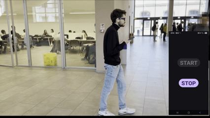
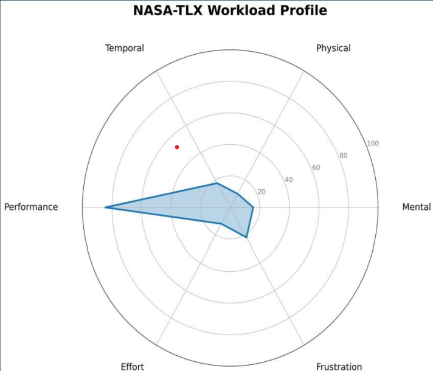
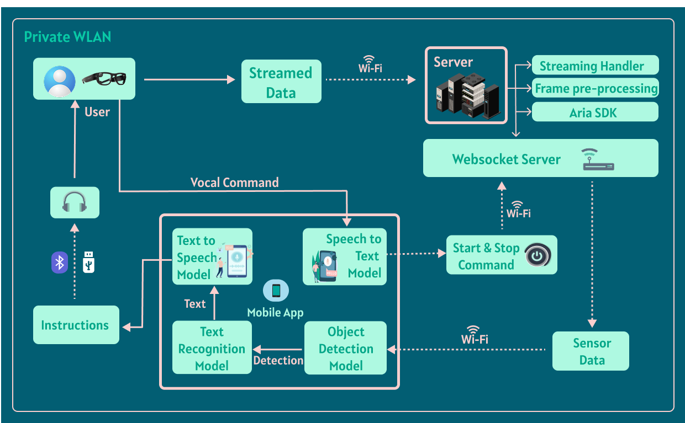
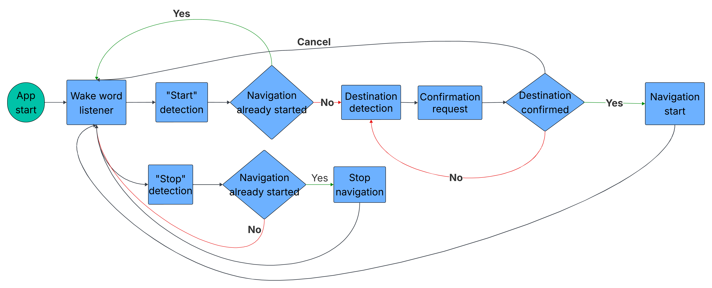

# Project Aria Indoor Navigation

**Hands-free indoor navigation for blind and low-vision users, using Meta Project Aria smart glasses, on-device object detection and voice control.**

*MSc thesis, Politecnico di Torino: [Bridging the Accessibility Gap: Leveraging Egocentric Vision for Indoor Navigation](https://webthesis.biblio.polito.it/39925/)*

[](https://youtu.be/VixqrmUZ1rQ)
<p align="center"><i>🔊 Click to watch the full demo with audio: the app guides the wearer to a room by voice.</i></p>

---

## What it does

Finding a room in an unfamiliar building usually means reading signs, which is hard or impossible for blind and low-vision (BLV) people. This system lets the user ask for a destination by voice and walk there while wearing smart glasses. Their hands stay free, and they get spoken directions along the way.

- **Egocentric vision:** the glasses' RGB camera streams what the wearer sees.
- **Detection and signage reading:** a YOLO model finds doors, signs and safety exits, and text recognition reads room names and directional signs.
- **Voice interface:** wake word, start and stop commands, and spoken destination confirmation, all handled by offline speech-to-text and text-to-speech.
- **Informed by users:** the design follows a preliminary study of the preferences and needs of BLV individuals.

## Results

| Metric | Value |
|---|---|
| Detection (YOLOv11, ~4,000 training images) | **mAP@0.5 = 0.94** |
| YOLOv11 average inference time              | **~138 ms** |
| End-to-end inference on Android (TFLite)    | **~150 ms** |

In user testing (N = 10), all participants reached their destination. The system scored **SUS 87/100 (grade A: excellent usability)**; workload was assessed with the **NASA-TLX**.



## How it works

### System architecture



1. The **Aria glasses** stream sensor data over Wi-Fi to a **desktop server** (Aria SDK, streaming handler, frame pre-processing).
2. The server forwards the frames through a **WebSocket server** to the **Android app**.
3. On the phone, the **object detection model** produces detections and the **text recognition model** reads the signs. The result is turned into text and spoken by the **text-to-speech model**, which sends instructions to the user's headphones (Bluetooth or USB).
4. The user's **vocal commands** go through the **speech-to-text model**, which sends start and stop commands back to the server.

### Voice interface



The app idles on a wake-word listener. After the wake word, a **"start"** command begins navigation: the app asks for a destination, repeats it for confirmation, and starts guidance only when the user confirms. A **"stop"** command ends an active navigation. The user can cancel at any point to return to the wake-word listener.

## Repository structure

```
├── android/   Android app: LiteRT/TFLite YOLO, ML Kit text recognition,
│              Vosk offline speech-to-text, text-to-speech, OpenCV (native)
├── server/   Python server: connects to Project Aria via the SDK and
│              forwards frames to the app over WebSocket
└── docs/      Diagrams and demo media
```

## Quick start

> **Requires Meta Project Aria glasses** and access to the Aria SDK. The phone and the computer must be on the same network.

### 1. Desktop server → [`server/`](server/)
- Python **3.11** (3.12 is not supported)
- Create a virtual environment and `pip install -r requirements.txt`
- Configure `config.ini`, then follow [`desktop/README.md`](server/README.md) to start the server: `python -m aria_desktop`

### 2. Android app → [`android/`](android/)
- Android Studio (Ladybug or newer), **JDK 17**, Android SDK 36, NDK + CMake
- Add the models to `android/app/src/main/assets/` 
- Set the server address in `WebSocketViewModel` (`ws://<server-ip>:8080`)
- Open the `android/` folder, sync, and run on a physical device (Android 13+ recommended; GPU-accelerated LiteRT)

Details and troubleshooting: [`android/README.md`](android/README.md).

## Tech stack

Kotlin · C++ / CMake (NDK) · OpenCV · YOLOv11 (Ultralytics → TFLite / LiteRT) · Google ML Kit · Vosk · Python 3.11 · WebSocket · Meta Project Aria SDK

## Limitations and future work

This system is only capable of suggesting directions based on what is detected in real-time. No global map is available, and the system does not know the user’s position or orientation relative to the destination. 

To build upon this foundation, the following areas are proposed for future work:
- Hybrid Localization: Integrating lightweight IMU-based dead reckoning or
low-overhead SLAM to provide approximate distance-to-target estimations;
- Enhanced Spatial Context: Developing a "Global Map" layer that allows the
system to provide proactive guidance even when signs are not immediately
visible in the current frame;
- Dynamic Obstacle Integration: Incorporating depth-sensing data (if hardware
permits) or secondary detection models to notify users of temporary hazards
or moving obstacles in their path;
- Leveraging the Project Aria eye-tracking cameras to narrow the system’s
"attentional bottleneck." By understanding exactly where the user is looking,
the system could prioritize processing for specific regions of interest, improving the accuracy of object detection and OCR while reducing unnecessary
computational load

## Thesis

📄 [Read the full thesis (PDF, 78 pages)](https://webthesis.biblio.polito.it/39925/1/tesi.pdf)
Supervisors: Federico Manuri, Andrea Sanna

## Author

**Michele Perseo** · [LinkedIn](https://www.linkedin.com/in/michele-perseo-59b180268)


## License

Code: [PolyForm Noncommercial 1.0.0](LICENSE). Free to read, use and modify for non-commercial purposes (research, education, personal projects).
For commercial use, please contact me.
Thesis text: CC BY-NC-ND 3.0 (see the [thesis page](https://webthesis.biblio.polito.it/39925/)).
